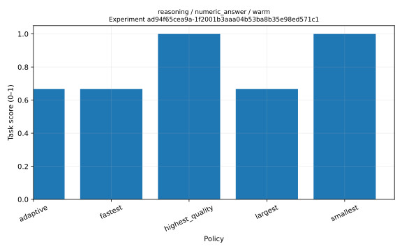
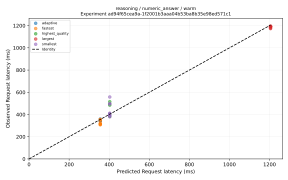

# AdaptiveEdge

> Publication status: Supporting material is being published in stages. The source test suite and CI workflow are excluded from this checkout, and no tests or live benchmarks have been run as part of the transfer. Baseline measurements below describe the archived source run, not measurements produced by this checkout.

AdaptiveEdge is an experimental framework for benchmarking and dynamically selecting local language models under compute constraints. It records quality, latency, memory and throughput across configurations to investigate whether adaptive policies can preserve quality while reducing computational cost.

Version 0.1.0 is a research release candidate with a measured, preliminary three-model baseline. Its small authored task suite demonstrates the workflow and exposes selection failures; it does not establish general superiority. The mock backend remains a functional fixture only.

## Problem and research question

Local model choice involves competing quality, latency, throughput and memory objectives. A single large model can waste resources on easy requests, while a fixed small model can lose quality on difficult tasks. AdaptiveEdge makes that tradeoff measurable and the selection decision inspectable.

**Can adaptive selection substantially reduce inference latency and resource consumption while preserving most of the output quality of always using the empirically strongest available model?** This is an open question for each dataset, model inventory and hardware environment.

## Features

- Validated model, task, hardware, inference and constraint records.
- Sequential benchmarking with repetitions, explicit warm/cold modes, timeouts and durable failures.
- Deterministic testing backend and streaming Ollama integration.
- Normalized labels/extraction, numeric answers, token F1 and restricted executable code fixtures.
- Sampled client process RAM and optional NVML hardware detection with explicit measurement scope.
- Append-only SQLite observations, environment manifests and archived task reproduction.
- Six deterministic policies: smallest, largest, fastest, highest-quality, lowest-memory and adaptive.
- Historical median prediction, hard constraints, Pareto filtering, configurable utility and structured explanations.
- Frozen-evidence held-out policy evaluation with failures, abstentions and observed constraint compliance.
- Task-level bootstrap intervals, prediction errors, descriptive policy effects and an equal-weight ablation.
- JSON/CSV tables, Markdown reports and optional high-resolution SVG/PNG research figures.
- Strict typing and source/repository audit tools. The source test suite and CI are excluded from this staged checkout.

## Architecture

```text
CLI / API -> sequential runner -> backend + profiler + task metrics
                          -> append-only SQLite + experiment manifests
historical records -> predictor -> constraints -> Pareto utility -> selection
raw records -> descriptive statistics -> Markdown / JSON / CSV / optional plot
```

Core runtime dependencies are Pydantic, PyYAML, psutil and Typer. HTTP, plotting, GPU detection and future heavy ML integrations use optional extras. See [architecture](docs/architecture.md) and [selection mathematics](docs/selection.md).

## Installation

Python 3.11 or newer is required. The source CI targets 3.11–3.13 on Windows and Linux; that workflow is excluded here.

```text
python -m venv .venv
```

Activate on Windows PowerShell:

```powershell
.\.venv\Scripts\Activate.ps1
```

Activate on Linux/macOS:

```bash
source .venv/bin/activate
```

Then install:

```text
python -m pip install -e ".[dev,ollama,plotting]"
adaptiveedge doctor --json
```

Minimal runtime installation is `python -m pip install -e .`. Extras are `dev`, `ollama`, `plotting`, `gpu`, `transformers` and `all`. The `transformers` extra installs dependencies only; its adapter is future work. `all` installs heavy ML packages and is unnecessary for the initial workflow.

## Quick start: functional benchmark and adaptive inference

```text
adaptiveedge benchmark run configs/benchmarks/basic.yaml --db adaptiveedge.db --json
adaptiveedge benchmark list --db adaptiveedge.db --json
adaptiveedge select --task reasoning --db adaptiveedge.db --json
adaptiveedge select --task reasoning --max-latency-ms 30 --db adaptiveedge.db --json
adaptiveedge run --task reasoning --input-file configs/examples/input.txt --max-latency-ms 30 --db adaptiveedge.db --json
```

The benchmark records 30 observations: two mock configurations × five functional tasks × three repetitions. Warm-ups are excluded. The unconstrained reasoning selector chooses the high-quality fixture; the 30 ms latency constraint selects the faster fixture. These properties are explicitly programmed test scenarios, not real-model findings.

Example fixture behavior, abbreviated:

```text
Selected mock-small using adaptive
predicted latency: 20 ms
predicted RAM: 0.5 GB
simulated: true
```

The full JSON response includes every candidate, predictions, violations, utilities and the selected configuration. These values are synthetic mock properties. Actual request timings and server usage come from real backends only.

The Python API is asynchronous for execution:

```python
import asyncio
from adaptiveedge import AdaptiveEdge, Constraints


async def main():
    edge = AdaptiveEdge("adaptiveedge.db")
    try:
        response = await edge.run(
            task="reasoning",
            input_text="Return only the answer: 6 * 7",
            constraints=Constraints(max_latency_ms=30),
        )
        print(response.selection.reason)
        print(response.output)
    finally:
        edge.close()


asyncio.run(main())
```

Bootstrap historical evidence with the benchmark command first. Unknown required measurements fail constraints; an empty feasible set returns no inference rather than running a violating model.

## Benchmark real Ollama models

Install/start Ollama and explicitly install the models you intend to study. AdaptiveEdge never downloads models. List installed tags, copy the template, and replace its clearly marked placeholders:

```text
adaptiveedge models --backend ollama --json
adaptiveedge benchmark run configs/benchmarks/ollama.local.yaml --db ollama.db --json
adaptiveedge select --task reasoning --max-latency-ms 800 --db ollama.db --json
adaptiveedge run --task reasoning --input-file configs/examples/input.txt --db ollama.db --json
```

Create `ollama.local.yaml` from `configs/benchmarks/ollama.template.yaml` before running these commands. Use a separate database to avoid mixing mock candidates with real candidates. Device placement is server-managed. Ollama server model RAM/VRAM is currently unmeasured; client RSS cannot satisfy model-memory constraints. See [benchmark instructions](docs/benchmarking.md).

## Reports, exports and reproduction

Replace `EXPERIMENT_ID` with an ID returned by a benchmark command:

```text
adaptiveedge benchmark show EXPERIMENT_ID --db adaptiveedge.db --json
adaptiveedge benchmark reproduce EXPERIMENT_ID --db adaptiveedge.db --json
adaptiveedge report EXPERIMENT_ID --db adaptiveedge.db --output outputs/report --plots
adaptiveedge export EXPERIMENT_ID outputs/results.json --db adaptiveedge.db
adaptiveedge export EXPERIMENT_ID outputs/results.csv --db adaptiveedge.db
```

Reports contain `report.md`, `summary.json`, `research.json`, `manifest.json`, raw JSON/CSV, aggregate/policy/effect/prediction-error CSV tables and optional SVG/PNG figures. Raw observations and derived statistics remain separate. Reports stratify by task/dataset/hardware/mode/simulation context instead of averaging incompatible quality metrics. Missing measurements are null/empty with explicit status, not zero.

## Policy experiments

```text
adaptiveedge evaluate TRAINING_ID configs/benchmarks/evaluation-smoke.yaml --allow-overlap --db adaptiveedge.db --json
python experiments/run_experiment.py configs/benchmarks/basic.yaml configs/benchmarks/evaluation-smoke.yaml --smoke --db adaptiveedge.db --output outputs/experiment
```

These are functional pipeline checks with overlapping mock tasks. For research, supply disjoint calibration and held-out custom task configs and omit overlap/smoke flags. Freeze model hashes, environment and training evidence; tune weights on validation data rather than test tasks. See [hypotheses](research/hypotheses.md) and [experiment guide](experiments/README.md).

## Preliminary real baseline

Run the authored baseline after explicitly pulling its three small artifacts:

```text
ollama pull qwen2.5:0.5b
ollama pull smollm2:1.7b
ollama pull qwen3:4b
python experiments/baseline_real.py --output outputs/baseline-real
python scripts/curate_results.py
```

The completed run used Windows, an Intel Core Ultra 7 265K and an NVIDIA RTX 4070 Ti. The original profile was frozen before NVML support was installed; the manifest contains a supplemental postrun GPU snapshot. Calibration and held-out prompts/IDs are disjoint, but share simple task templates. Weights were declared before evaluation; no validation tuning was performed. See the [generated report](examples/results/baseline-real/report.md), [manifest](examples/results/baseline-real/manifest.json) and [methodology](docs/methodology.md).

<!-- BEGIN GENERATED BASELINE -->
## Adaptive versus highest-quality policy

Highest-quality means the policy selected from calibration; it is not a held-out oracle. Each row uses its own task metric. Negative latency reduction means slower. No pooled quality score is calculated.

| Category | Adaptive quality | Reference quality | Quality retention | Latency reduction | Latency MAE (ms) | Quality MAE |
|---|---:|---:|---:|---:|---:|---:|
| classification | 0.667 | 0.667 | 100.00% | -1.10% | 6.73 | 0.333 |
| code | 0.889 | 0.889 | 100.00% | -0.11% | 44.11 | 0.556 |
| extraction | 1.000 | 1.000 | 100.00% | 8.58% | 13.95 | 0.000 |
| reasoning | 0.667 | 1.000 | 66.67% | 18.47% | 8.50 | 0.333 |
<!-- END GENERATED BASELINE -->

Model peak memory is unavailable and the lowest-memory policy abstained throughout. Other policies served their requested tasks without inference failures; request coverage is in the generated report. The reasoning result shows a quality loss, not a universal improvement. Intervals are explicitly limited by the tiny independent task sample. Latency comparisons are descriptive and affected by fixed order, prompt caching and background work.





## Methodology and reproducibility

The system distinguishes request latency, server generation time, loading time, TTFT, client RSS and model-runtime memory. Seeds are explicit; raw results are immutable; partial experiments survive cancellation. Manifests preserve configuration hashes, tasks, hardware and software/runtime metadata. A rerun cannot guarantee bitwise identity or unchanged mutable model tags.

Lexical scoring is a controlled functional metric and does not establish human quality. Statistical summaries are descriptive; repeated prompts are not independent samples for population uncertainty. Read [methodology](docs/methodology.md), [reproducibility](docs/reproducibility.md) and [security/privacy](SECURITY.md) before collecting publication data.

## Testing and quality checks

The source tests and CI workflow are not included in this checkout. The commands below document the complete source release workflow; they are not a record of checks performed during this transfer.

```text
ruff check .
ruff format --check .
mypy src
pytest --cov-fail-under=94.28
python scripts/audit_source.py
python scripts/audit_repository.py
python -m build
```

The source default tests require no network, GPU, Ollama service or model downloads. Ollama contracts use an in-memory HTTP transport. Optional plotting tests skip if Matplotlib is absent. The source CI installs test extras and checks Windows/Linux across Python 3.11–3.13. No CI badge is shown before an actual public repository and successful workflow exist.

## Status, limitations and roadmap

V0.1 implements mock and Ollama adapters. Model peak RAM/VRAM is unavailable, so lowest-memory abstains on real observations and memory constraints fail when required evidence is absent. The restricted code evaluator accepts pure expression fixtures; it is not a general Python sandbox. Historical medians have no probabilistic guarantees. Tags, runtimes, cache state and hardware can drift. Remote CI has not run before publication.

The small baseline shares task templates across splits and uses one personal desktop with background activity. See [threats to validity](research/threats_to_validity.md). Further research can use external datasets, counterbalanced runs, calibrated prediction, validated server profiling or additional adapters. These are extensions, not claims established by this release. Transformers dependencies remain an optional installation extra; its execution adapter is not implemented.

## Citation and license

Use [CITATION.cff](CITATION.cff) to cite the exact release used. Add an archival DOI only after an actual release exists. AdaptiveEdge is licensed under [MIT](LICENSE). Dataset and model licenses remain independent.

Contributions: [setup and quality requirements](CONTRIBUTING.md). Research positioning: [related work](research/related_work.md) and [paper starter](research/paper_outline.md).
