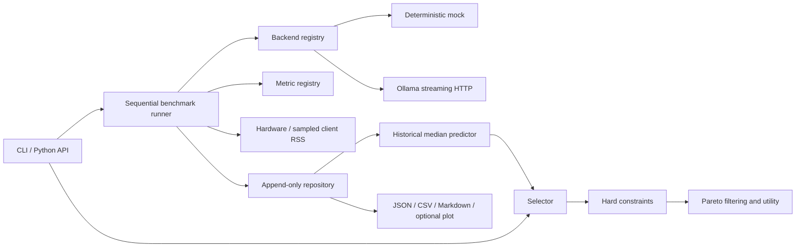

# Architecture

AdaptiveEdge separates data contracts from execution, persistence and decision-making. Pydantic records reject extra fields and nonfinite values and freeze field assignment. Containers inside records are not deeply frozen; callers must treat them as values. Canonical JSON snapshots and content hashes preserve the values actually recorded.

## Boundaries

`core` contains validated records, canonical hashing and UTC timestamps. `config` loads YAML/TOML. `backends` defines an asynchronous protocol, availability/discovery/validation and full inference records. Streaming is an adapter implementation detail; token counts and TTFT are optional. The registry is injected into runners and the API. Optional HTTP dependencies are imported only when used.

`datasets` exposes a task-provider protocol and a versioned five-task functional suite. External dataset adapters should require explicit download/import commands and return materialized, versioned tasks. `metrics` uses a callable registry. `profiling` records host information, optional NVML device information and sampled client process RSS. Model-server memory remains unavailable unless a backend can measure it with a defensible scope.

`benchmarks` runs sequentially. Availability checks and warm-ups precede measured repetitions. Every measurement or failure is committed separately. Cancellation propagates; a lifecycle event records interruption. Backend, validation and metric errors are captured per configuration or task. Infrastructure failures propagate instead of being misclassified as model failures.

`storage` alone owns SQL. Schema version 2 uses experiments, models, tasks, hardware, runs, inference measurements, quality metrics, failures and lifecycle events. Structured JSON retains the complete domain records; normalized IDs and metric rows support joins. Each result transaction writes all associated rows atomically. Triggers reject updates/deletes of raw data. Unknown schema versions fail explicitly. Migrations must be sequential, transactional and preserve raw measurements; the version 1-to-2 migration adds explicit split columns without rewriting raw JSON.

`selection` depends on domain records and predictor/policy protocols. The historical predictor does not call backends. Constraints reject missing required measurements. Six policies implement a shared score interface. The adaptive policy filters dominance and scores normalized objectives. Candidate order and tie-breaking are explicit. `reporting` regenerates derived statistics without mutating observations.

`api` coordinates the layers; importing `AdaptiveEdge` does not connect to a database, service or GPU. The explicit instance opens SQLite. The CLI delegates to the same layers and converts anticipated user errors into exit codes. `AdaptiveEdge.close()` releases database resources. Async methods require `await`, or `asyncio.run` outside an existing event loop.

## Extension rules

Inject a backend registry, predictor, selector or metric registry rather than editing orchestration code. Policies can be registered on `Selector`. Dataset providers materialize tasks into custom configs. Exporters consume typed records; Parquet can be added without schema changes. GPU vendor adapters can implement the same measurement statuses and scope convention. Optional dependency groups isolate heavy runtimes.

Transformers and llama.cpp adapters are future work. The `transformers` extra reserves an integration environment; it does not register a working adapter. This release prioritizes the implemented Ollama adapter and portable offline tests.

The research reporting layer aggregates repetitions within independent tasks, estimates bootstrap uncertainty, exports comparative effects and selected-candidate prediction errors, and generates SVG/PNG plots. The code metric uses a bounded AST interpreter in an isolated subprocess, not generated Python execution. See methodology and SECURITY.md for its deliberately narrow capability boundary.
